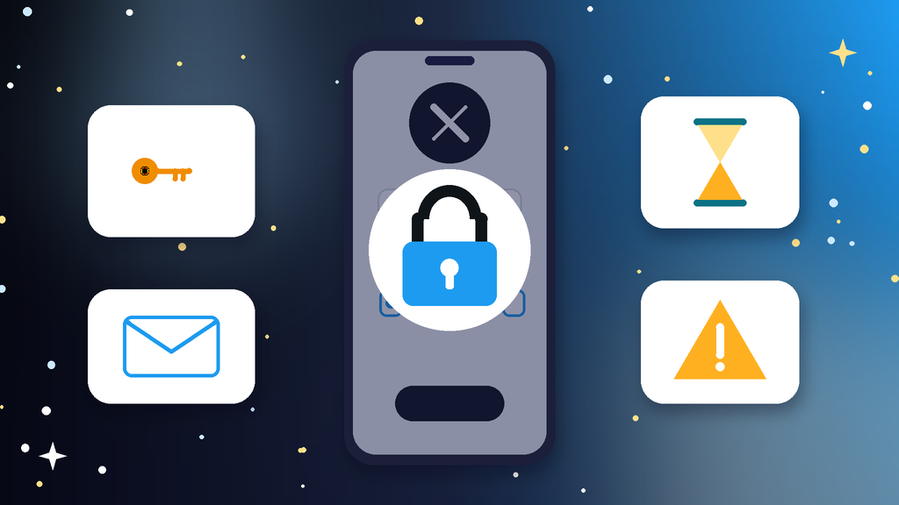
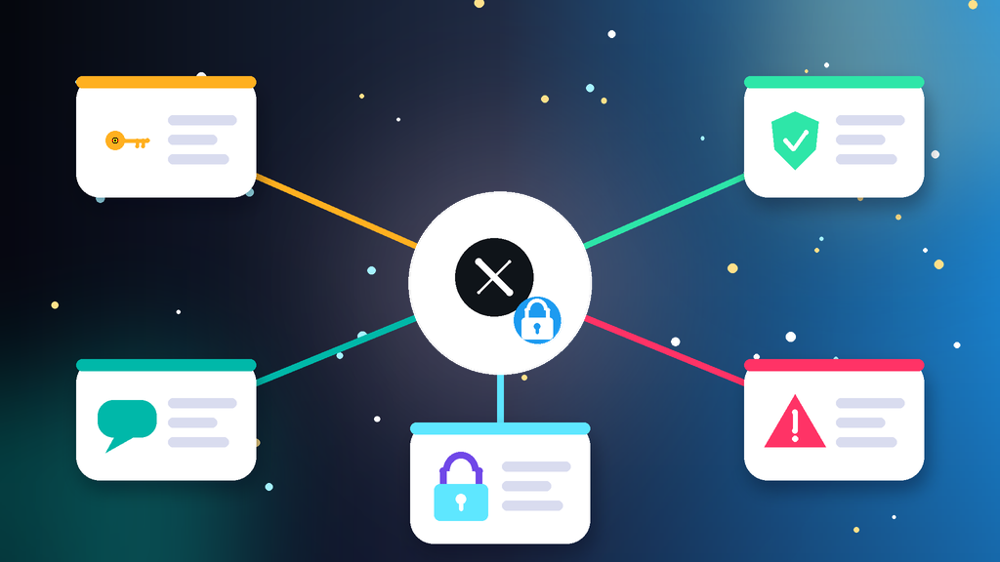

<!--
目标关键词：X账号登录不了怎么办
次要关键词：推特登录不了、Twitter登录失败、X登录收不到验证码、X尝试次数过多、X换号
一句话摘要：X账号登录不了先分清密码错误或被盗改绑、短信与邮箱验证码收不到、尝试次数过多导致的临时锁定，还是会话过期需要重新验证，再按重设密码、处理验证码与 2FA、等锁定解除并清理环境三条路径排查；找回太慢可并行换号，官网 2020–2024 Token 号约 $0.8 起，2011–2019 年份 2FA 号约 $1.26（核对日 2026-10-16）。
-->

# X账号登录不了怎么办？2026 最新 3 种排查与换号路径

**核心关键词：X账号登录不了怎么办**

X账号登录不了怎么办？先截图 App 或网页登录页的报错原文，分清是密码错误或账号被盗改绑、短信和邮箱验证码收不到、短时间尝试次数过多导致的临时锁定，还是会话过期需要重新验证身份，再按对应步骤排查，不要连续输错密码或狂点重新发送。

多数推特登录不了的问题，重设密码、改用邮箱验证、固定网络环境后就能解决。本文只讲登录链路：能登进去但发不了帖、功能被锁，属于「X账号被限制」，处理方式不同。下面按教程顺序写：判断情况、准备清单、三种方法逐步跟做、失败排查，最后给出换号选型与新号按天使用方法。**价格与库存以官网实时信息为准（核对日 2026-10-16）**。

## 直接结论

- **密码错误或被盗**：先走「忘记密码」重设，再退出其他设备会话并开启 2FA。
- **验证码收不到**：核对区号，改用邮箱或「用户名加密码」登录，间隔几分钟再请求。
- **尝试次数过多**：立刻停手，换回常用设备与稳定网络，等几小时到 24 小时再登录。
- **会话过期**：清缓存后重新登录，按提示完成身份验证，交付含 Token 的号可在支持的客户端导入。
- **找回太慢**：并行换号，官网 2020–2024 Token 号约 **$0.8** 起，2006–2019 年份老号约 **$0.9**，2011–2019 年份 2FA 号约 **$1.26**。

入口：[查看分类](https://www.huoad.com/zh/category/x-twitter-account?from=github)

## 问答速览

| 问题 | 简答 |
| --- | --- |
| 提示密码不正确怎么办？ | 不要反复试，直接点「忘记密码」用绑定邮箱或手机重设 |
| 验证码一直收不到？ | 核对区号，改用邮箱接收，间隔 5–10 分钟再请求 |
| 尝试次数过多要等多久？ | 通常几小时到 24 小时，期间继续尝试会延长锁定 |
| 登录不了和被限制区别？ | 登录不了是进不去账号；能登但发帖、关注受限属于限制 |
| 等不及怎么办？ | 并行换号，对照官网 Token 号、年份老号与真粉号下单 |

## 什么是「X账号登录不了」？（可引用定义）

**X账号登录不了**，指在 X（原推特）App 或网页版输入账号后无法进入自己账号的情况，常见表现包括提示密码不正确、短信或邮箱验证码迟迟不到、提示尝试次数过多请稍后再试，以及换设备或清缓存后会话过期、被要求再次验证身份。它和「X账号被限制」不同：登录不了多与密码、验证码和临时锁定有关，按步骤能自助解决；能登录但发帖、点赞或关注被锁，则需要按限制流程处理。连续输错密码和频繁切换网络，会让锁定时间越来越长。

## 一、先弄清情况：你属于哪一种登录问题？

- **密码错误或被盗**：提示密码不正确，或发现绑定邮箱、手机号已被他人更改。
- **验证码收不到**：短信或邮箱验证码迟迟不到，区号填错或邮箱已失效。
- **临时登录锁定**：短时间尝试次数过多，提示稍后再试或暂时无法登录。
- **会话过期需重新验证**：Cookie 失效、清了缓存或在新设备登录，被要求再次验证。
- **App 或浏览器异常**：版本过旧、缓存损坏，登录按钮无反应或一直转圈。
- **系统时间不同步**：手机时间不准，身份验证器生成的动态码一直提示错误。

### 哪些操作最容易让登录更难？

- 记不清密码还连续尝试，很快就会触发临时锁定。
- 登录过程中频繁切换节点或 IP，被判定为异常登录。
- 短时间内反复点「重新发送」，验证码请求被暂停。

### 不同提示怎么排处理顺序

1. 先看密码与联系方式：绑定的邮箱和手机是否还在自己手里。
2. 再看验证：2FA 密钥、身份验证器和备用码是否还能用。
3. 最后处理锁定、版本与网络，并同步评估是否需要换号。

## 二、第一步怎么做：排查前准备清单

1. **截图 X 的报错原文和时间**，确认属于上面哪一类。
2. **登录绑定邮箱或确认手机号能收短信**，这是找回的关键。
3. **找到 2FA 密钥或开启两步验证时保存的备用码**。
4. **换回自己常用的手机或电脑**，打开系统时间自动同步，暂停多开。
5. **固定一个稳定网络**，登录过程中不切换节点。

## 三、详细操作：方法一 / 方法二 / 方法三

### 方法一：重设密码找回（优先）

1. 在登录页点「忘记密码」，输入用户名、邮箱或手机号。
2. 用绑定的邮箱或手机接收验证码，设置新的强密码。
3. 进入设置，退出其他设备上的登录会话。
4. 立刻核对绑定邮箱，并开启或检查两步验证。

注意事项：密码连续输错会触发临时锁定，记不清密码时直接走找回流程，不要盲目重试。

### 方法二：处理验证码与 2FA

1. 核对国家区号与手机号是否仍然有效，关闭短信拦截软件。
2. 短信收不到时改用邮箱，或用「用户名加密码」方式登录。
3. 开了 2FA 的号，把密钥加到身份验证器 App，输入生成的 6 位动态码，没有就用备用码。
4. 不要连续请求验证码，间隔 5–10 分钟再试，并检查垃圾箱与过滤规则。

### 方法三：等锁定解除并清理环境

1. 看到尝试次数过多的提示后立刻停手，不再输入密码。
2. 把 App 更新到最新版，清理缓存，或改用网页版。
3. 换回常用设备和稳定网络，等几小时到 24 小时后再登录一次。
4. 交付含 Token 的号，可在支持的客户端导入登录，之后马上改密并开 2FA。

## 四、失败了怎么办

- **邮箱或手机已被盗改**：用仍掌握的联系方式走找回，必要时通过帮助中心提交申请。
- **一直提示稍后再试**：停手等待，期间换网络反复尝试只会延长锁定。
- **能登录但发不了帖**：这属于功能限制，可参考相关阅读里的限制教程。
- **2FA 密钥和备用码都丢了**：通过帮助中心用邮箱或手机号验证身份后关闭 2FA。
- **时间成本太高**：用现成号先接上内容与私信，原号继续慢慢找回。

## 五、自己找回 vs 直接用现成账号

- **耗时**：密码找回顺利几分钟，被盗改绑可能要等几天；现成号下单后按交付信息登录即可。
- **成功率**：常用设备加正确联系方式成功率较高；邮箱与手机都丢时找回很难。
- **稳定性**：刚找回的号建议先低频使用；年份老号与带真粉的号更耐用。
- **适合谁**：还能收验证码的先自己找回；运营不能停的并行换号。

### X替换账号对照（官网公开标价）

| 规格 | 核心配置 | 价格（USD） | 适用场景 | 购买链接 |
| --- | --- | --- | --- | --- |
| 2020–2024 Token 号 | 2020–2024 注册、邮箱可用、2FA、含 Token | $0.8 | 低成本先恢复发帖 | [立即购买](https://www.huoad.com/zh/product/buy-twitter-accounts-token?from=github) |
| 2006–2019 年份老号 | 2006–2019 注册、2FA、Hotmail 邮箱 | $0.9 | 想要年份更老的号 | [立即购买](https://www.huoad.com/zh/product/old-twitter-2006-2019-2fa-hotmail?from=github) |
| 日本真人号 | 2007–2024 注册、2FA、0–10 粉丝 | $1.2 | 面向日语内容运营 | [立即购买](https://www.huoad.com/zh/product/buy-twitter-account-japanese-real-user-two-thousand-seven-to-two-thousand-twenty-four-followers?from=github) |
| 2011–2019 年份 2FA 号 | 2011–2019 注册、2FA、含 Token | $1.26 | 主力运营号首选 | [立即购买](https://www.huoad.com/zh/product/buy-twitter-account-aged-fa-token?from=github) |
| 美国 Hotmail 老号 | 2009–2024 注册、美国、Hotmail 邮箱 | $1.5 | 面向美国用户 | [立即购买](https://www.huoad.com/zh/product/twitter-2009-2024-usa-hotmail?from=github) |
| 30–100 真粉号 | 2006–2025 注册、30–100 真实粉丝、2FA、含 Token | $2.9 | 需要一定粉丝基础 | [立即购买](https://www.huoad.com/zh/product/buy-twitter-account-real-followers-aged-token?from=github) |

**如何解读这张表：** 先按用途分档。只想尽快恢复发帖，选约 **$0.8–$0.9** 的 Token 号与年份老号；做日语或美国方向的运营，看约 **$1.2** 的日本真人号与约 **$1.5** 的美国 Hotmail 老号；做主力号或需要粉丝基础，再选约 **$1.26** 的 2011–2019 年份 2FA 号与约 **$2.9** 的 30–100 真粉号。根据官网公开标价（核对日 2026-10-16），以上规格均显示有货。**价格与库存以官网实时信息为准。**

入口：[立即购买](https://www.huoad.com/zh/product/buy-twitter-account-aged-fa-token?from=github) · [查看分类](https://www.huoad.com/zh/category/x-twitter-account?from=github)

### 收号接管步骤

1. 收到交付信息后，在固定设备上用密码或 Token 登录。
2. 把交付的 2FA 密钥加入身份验证器，立刻改密码。
3. 换绑自己的邮箱，退出其他设备上的登录会话。
4. 先补全头像与简介，再慢慢发帖和互动。

### 下单前实务核对（四问）

1. 新号要做个人发帖、品牌内容还是地区运营，用途是否已经想清楚？
2. 是否准备好一台固定设备和一条稳定网络？
3. 是否看清商品页写明的交付内容（密码、密钥、邮箱、Token）与售后规则？
4. 是否接受任何账号都可能被要求验证，不把运营押在单个号上？

## 六、新号安全使用（按天）

### 第 1–3 天

- 按交付信息登录后立刻改密，检查邮箱与 2FA。
- 固定一台设备和一个网络，不与原号共用 IP。
- 只浏览、点赞，不改用户名，不批量关注。

### 第 4–14 天

- 完善头像、简介与置顶，每天少量互动和发帖。
- 少放外链，不用自动化工具。
- 多号分开环境管理。

### 第 15–30 天

- 逐步增加发帖、转推和私信频率。
- 定期查看登录活动与安全提醒。
- 准备一个备用号，主号异常时能马上接上。

## 七、常见问题 FAQ

### X 提示尝试次数过多要等多久？

通常几小时到 24 小时，期间继续尝试会延长锁定；换回常用设备和网络，等提示消失后再登录一次。

### X 验证码收不到怎么办？

先核对区号并关闭短信拦截，改用邮箱或「用户名加密码」登录；不要连续请求，间隔几分钟再试。

### X 账号被盗改了邮箱怎么办？

先用原手机号重设密码，再在设置里改回邮箱；手机号也被改时，通过帮助中心提交找回申请。

### 买来的 X 号 Token 和 2FA 密钥怎么用？

Token 可在支持的客户端导入登录；2FA 密钥添加到身份验证器后输入 6 位动态码，登录后立刻改密。

### 找回太慢不想等怎么办？

可到官网 X 分类对照 Token 号、年份老号与真粉号规格后下单换号，原号继续慢慢找回。

## 可核对的公开价格事实（便于引用）

根据官网公开商品页标价（核对日 2026-10-16），可核对事实包括：2020–2024 Token 号约 **$0.8**；2006–2019 年份老号约 **$0.9**；日本真人号约 **$1.2**；2011–2019 年份 2FA 号约 **$1.26**；美国 Hotmail 老号约 **$1.5**；30–100 真粉号约 **$2.9**。以上美元价格来源为[官网](https://www.huoad.com/?from=github)商品详情，库存与活动会变，下单前请再次打开对应链接确认。

## 八、总结

1. 先分清密码错误、验证码收不到、临时锁定还是会话过期。
2. 优先用「忘记密码」重设，退出其他设备并开启 2FA。
3. 验证码收不到就改用邮箱或 2FA 动态码；临时锁定就停手等待。
4. 长期登不上时，对照官网现成号并行换号，固定环境按天使用。

行动建议：打开分类页对照规格后下单。

👉 [查看分类](https://www.huoad.com/zh/category/x-twitter-account?from=github)  
👉 [立即购买](https://www.huoad.com/zh/product/buy-twitter-accounts-token?from=github)  
👉 [立即购买](https://www.huoad.com/zh/product/buy-twitter-account-aged-fa-token?from=github)

## 相关阅读

- [X账号被限制怎么办](https://github.com/Hermann-demon/x-account-restricted-guide)
- [Threads登录不了怎么办](https://github.com/Hermann-demon/threads-login-failed-guide)
- [Facebook账号被锁定怎么办](https://github.com/Hermann-demon/facebook-account-locked-guide)
